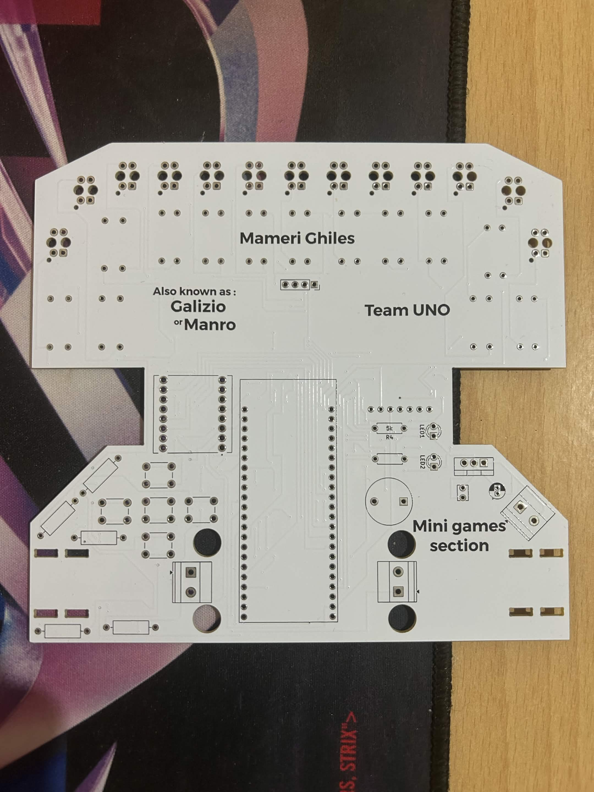
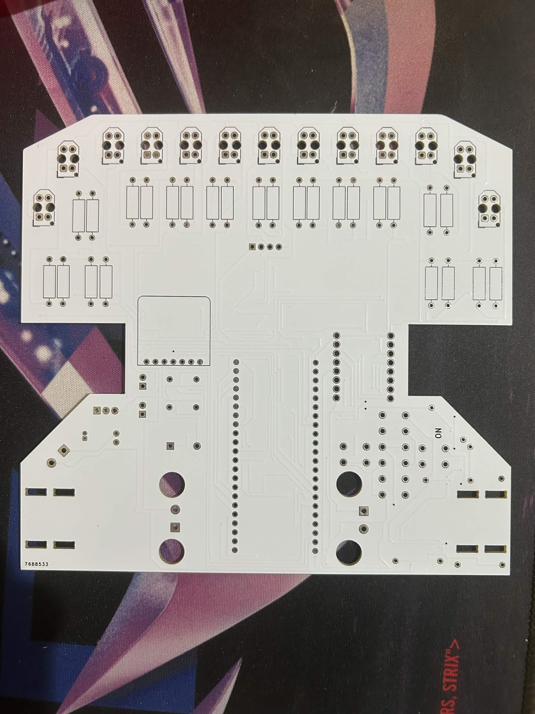

# PolyMaze Autonomous PCB Robot

## Overview
This project began as a custom QTR sensor array PCB for a line-follower and evolved into a fully integrated, single-board autonomous maze-solving robot. It was designed and manufactured from scratch to compete in the PolyMaze competition. 

By integrating the sensor array, processing logic, and motor drivers onto a single custom printed circuit board, the robot achieves a highly compact form factor, eliminates wiring faults, and serves as its own structural chassis.

## Key Features
* **Chassis-as-a-PCB (PCBaC):** Eliminates the need for a 3D-printed or acrylic frame, saving weight and reducing assembly time.
* **Integrated IR Sensing:** The bottom edge of the PCB houses the QTR array, ensuring consistent sensor-to-ground calibration.
* **High-Speed Navigation:** Designed for rapid line-tracking and junction detection using a tuned PID control loop.

## Visuals
### Physical PCB

### Design & Schematics

### 3D Renders

## Hardware Architecture
The hardware was designed from the ground up and routed in **KiCad 9.0**. The `PIDFollower` directory contains the complete schematic, PCB layout, and custom symbol libraries.

* **Microcontroller:** ESP32 Development Board. Chosen for its fast clock speed to handle high-frequency sensor polling and PID calculations, with built-in wireless capabilities for potential telemetry.
* **Motor Driver:** TB6612FNG Dual DC Motor Driver. Selected over older L298N drivers for its superior efficiency, lower voltage drop, and compact footprint.
* **Actuators:** N20 Metal Gear Motors. Provide the ideal balance of high torque and small size required for tight maze maneuvers.
* **Sensing:** Integrated QTR-8RC infrared sensor array. Uses RC discharge timing for precise analog-like readings of the line position and maze walls.
* **Power Regulation:** LM7805 5V Linear Voltage Regulator to safely step down battery voltage for the logic components.

## Software & Control Loop
* **PID Line Tracking:** The robot calculates the error between the center of the sensor array and the detected line. This error is fed into a Proportional-Integral-Derivative (PID) controller, which continuously adjusts the PWM signals sent to the left and right motors to maintain a smooth, high-speed trajectory.
* **Maze Mapping Algorithm:** Utilizes node-detection logic to identify intersections, dead ends, and turns, allowing the robot to navigate complex mazes autonomously.

## Repository Structure
* `/PIDFollower` - The main KiCad 9.0 project folder containing the `.kicad_pro`, `.kicad_sch`, and `.kicad_pcb` files.
* `/PIDFollower/Gerbers` - Manufacturing files ready to be sent to any standard PCB fabrication house (contains copper, mask, silkscreen, and drill files).
* `/PIDFollower/Logo.pretty` - Custom silkscreen logo footprints.

## Author
**Ghiles Mameri**  
Engineering Student in Automation & Control
