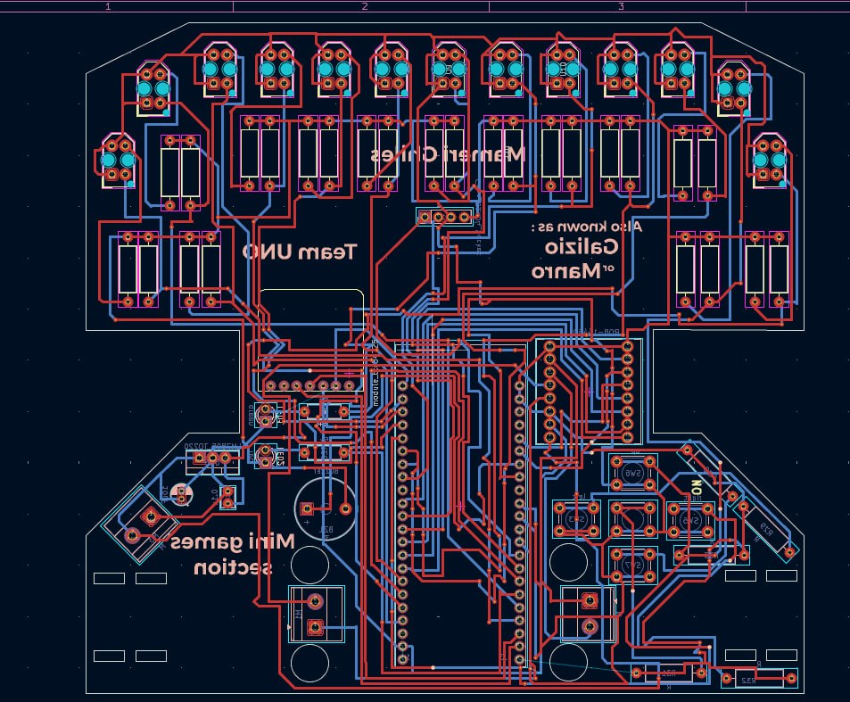
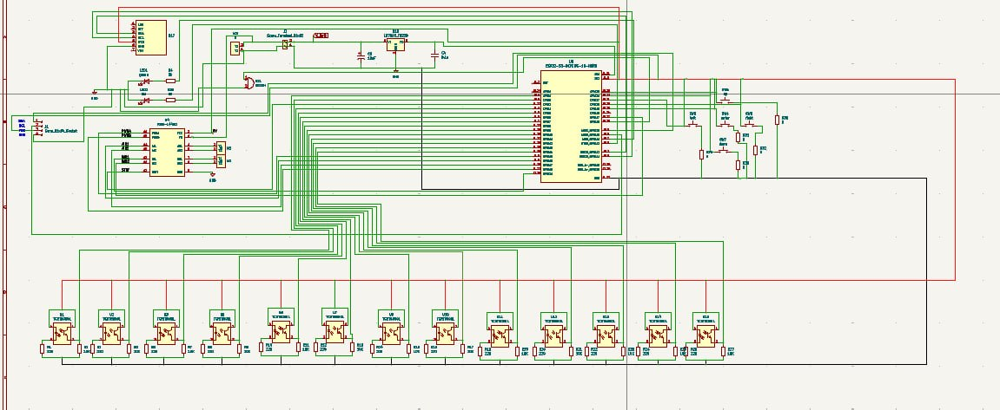
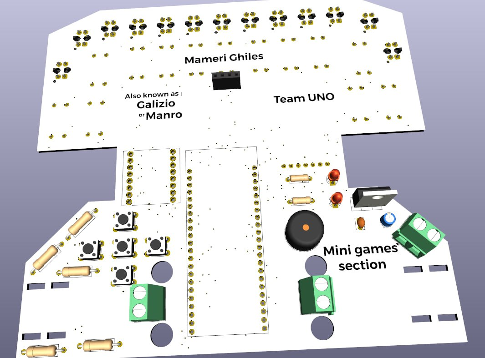
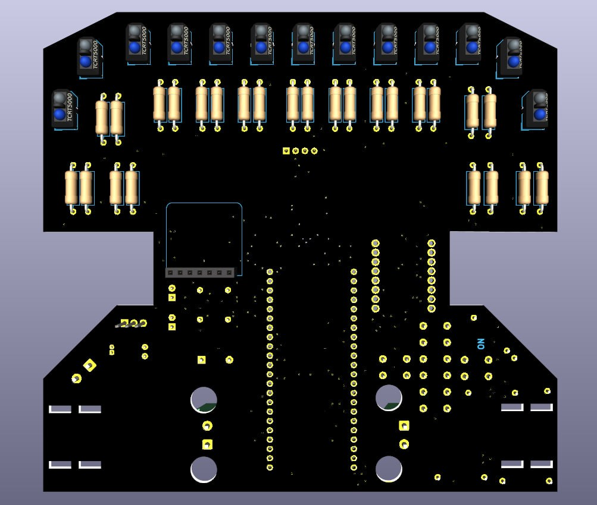

# PolyMaze Autonomous PCB Robot

## Overview
This project began as a custom QTR sensor array PCB for a line-follower and evolved into a fully integrated, single-board autonomous maze-solving robot. It was designed and manufactured from scratch to compete in the PolyMaze competition. 

By integrating the sensor array, processing logic, and motor drivers onto a single custom printed circuit board, the robot achieves a highly compact form factor, eliminates wiring faults, and serves as its own structural chassis.

## Visuals
### PCB Layout

### Schematic

### 3D Render - Top

### 3D Render - Bottom

## Hardware Architecture
The hardware is fully documented in the KiCad project files, featuring:
* **Microcontroller:** ESP32 Development Board
* **Motor Driver:** TB6612FNG Dual DC Motor Driver
* **Actuators:** N20 Metal Gear Motors
* **Sensing:** Integrated QTR-8RC infrared sensor array for precise wall and line detection
* **Power Regulation:** LM7805 5V Voltage Regulator
* **EDA Software:** Designed and routed completely in KiCad 9.0

## Software & Control
* **Algorithm:** Autonomous maze navigation and mapping.
* **Motion Control:** PID controller implemented for smooth, high-speed turning and line-tracking.

## Author
**Ghiles Mameri**  
Engineering Student in Automation & Control
